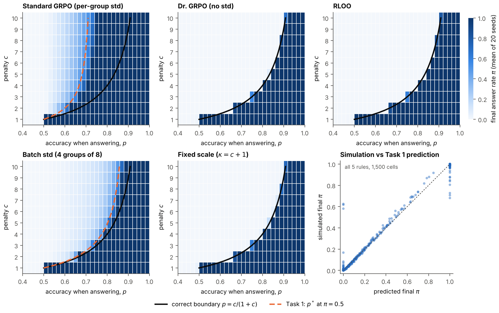

# GRPO advantage normalization under asymmetric rewards

ECE 59500 (Reinforcement Learning, Prof. Mahsa Ghasemi), Fall 2026.

GRPO rescales each answer's score by the spread of scores in its group. When a wrong answer costs much more than a right one earns (+1 / −5 / 0 for abstaining), that rescaling weakens the penalty, and the model answers where it should abstain. We measure how much, test which rescaling rules fix it while keeping the abstain option, and check whether the toy-problem results hold on a small language model.

Proposal: [`docs/proposal.pdf`](docs/proposal.pdf)

## Team and tasks

| Step | What | Owner | Due |
|---|---|---|---|
| 1 | Toy problem: exact math and simulation | Pallavi Buwa | Nov 13 (done) |
| 2a | LLM task: arithmetic dataset, ABSTAIN option, +1/−5/0 checker | Vidhya Thangavelu | Nov 18 |
| 2b | LLM training runs with TRL `GRPOTrainer` | Ashwin Sreedhar, Siddharth Murali | Nov 25 |
| 3 | Case study on the earlier 4B/8B code-review runs | Ashwin Sreedhar, Siddharth Murali | Nov 25 |
| – | Related work | All | Nov 25 |
| – | Final report | Ashwin Sreedhar | Dec 4 |

## Layout

```
docs/               proposal, Step 1 summary (final report goes here too)
step1_toy/          answer-or-abstain toy problem: derivation PDF, phase diagram, code
step2_llm/          Qwen3-0.6B + TRL experiments (in progress)
step3_case_study/   analysis of the code-review GRPO logs (in progress)
```

## Running Step 1

```
pip install -r requirements.txt
cd step1_toy
python grpo_exact.py      # thresholds for standard GRPO, Dr. GRPO, RLOO, fixed scale (prints GRPO p* vs answer rate and group size)
python batch_exact.py     # thresholds for batch-level std (prints p* for B = 1 to 64)
python run_grid.py        # 5 rules x 300 cells x 20 seeds (~2.5 min), writes grid.npz
python plot_phase.py      # phase_diagram.png
```

## Step 1 details

Full derivations: [`step1_toy/task1_grpo.pdf`](step1_toy/task1_grpo.pdf). Plain-language summary: [`docs/Step1_Summary.pdf`](docs/Step1_Summary.pdf).

### The toy problem

The model gets a question and either answers or abstains.

| Outcome | Reward |
|---|---|
| Correct answer | +1 |
| Wrong answer | −c (c = 5 in the proposal) |
| Abstain | 0 |

The policy has one parameter θ. The answer rate is π = sigmoid(θ). When the model answers, it is correct with a fixed probability p (its accuracy). Training changes only π. Accuracy is not learned.

Answering is worth p(1) + (1 − p)(−c) on average, and abstaining is worth 0. So the model should answer only when p > c/(1 + c). For c = 5 that cutoff is 5/6 ≈ 0.833.

### The five rules

Every rule samples a group of G responses to the same question and compares each reward to the group mean. They differ in what happens next.

| Rule | Advantage for response i | Code name |
|---|---|---|
| Standard GRPO | (r_i − group mean) / group std | `grpo` |
| Dr. GRPO | r_i − group mean | `dr` |
| RLOO | r_i − mean of the other G − 1 rewards | `rloo` |
| Batch std | (r_i − group mean) / std of every reward in the batch | `batch` |
| Fixed scale | (r_i − group mean) / κ, with κ = c + 1 | `fixed` |

`grpo` and `batch` follow TRL's `GRPOTrainer` (`scale_rewards="group"` and `"batch"`, checked in the TRL 1.18 source): Bessel-corrected std, plus 1e-4 in the denominator.

### Task 1: exact math (`grpo_exact.py`, `batch_exact.py`)

For each rule, the code computes the expected update to θ exactly. It does this by summing over every possible group composition (k correct, m wrong, G − k − m abstains), weighted by its multinomial probability. The threshold p* is the accuracy where the expected update changes sign. A correct rule has p* = c/(1 + c).

Results, c = 5:

- **Standard GRPO** has p* below 0.833 in every case. With G = 8 and π = 0.5, p* = 0.682. That is the same as a penalty of about −2.1 instead of −5. It is worst when the model rarely answers (p* = 0.528 at π = 0.05) and when groups are small (p* = 0.5 at G = 2).
- **A larger penalty does not fix standard GRPO.** At G = 8 and π = 0.5, c = 1000 gives p* = 0.737, which acts like a penalty of about −2.8. After rescaling, no advantage in a group of G can exceed (G − 1)/√G in size (2.47 for G = 8, with TRL's Bessel-corrected std; √(G − 1) = 2.65 with plain std), whatever c is.
- **Dr. GRPO, RLOO and fixed scale** give p* = c/(1 + c) exactly, for every c, G and π. They differ from each other only by a positive constant (1, G/(G − 1), 1/κ), which changes the step size and not the direction.
- **Batch std** with B groups of size G has exactly the same threshold as standard GRPO with one group of size B·G. It approaches c/(1 + c) as the batch grows, but never reaches it.

Standard GRPO threshold vs group size (c = 5, π = 0.5):

| G | 2 | 4 | 8 | 16 | 32 | 64 |
|---|---|---|---|---|---|---|
| p* | 0.500 | 0.583 | 0.682 | 0.759 | 0.802 | 0.821 |

### Task 2: simulation (`sim.py`, `predict.py`, `run_grid.py`, `plot_phase.py`)

`sim.py` trains the toy policy with plain SGD and checks that it ends where Task 1 predicts.

- One step: sample B = 4 groups of G = 8 responses (32 per step, the same for every rule), score them, compute advantages with the chosen rule, and move θ by η·ĝ with η = 0.5. θ is clipped to [−12, 12].
- Every run starts at θ = 0 (π = 0.5) and lasts 8,000 steps.
- The grid is p ∈ {0.41, 0.43, …, 0.99} by c ∈ {1, …, 10}, which is 300 cells, with 20 seeds per cell.
- The final answer rate is the mean of π over steps 7,001 to 8,000 and over the 20 seeds.

`predict.py` gives the answer rate each run should settle at:

- Dr. GRPO, RLOO and fixed scale go to 1 if p > c/(1 + c) and to 0 otherwise.
- For standard GRPO and batch std, p* rises with π. So the policy settles at a partial answer rate π̂, where the exact expected update is zero. Standard GRPO uses group size 8. Batch std uses group size 32, from the equivalence above.

Agreement between simulation and prediction:

| Rule | Mean abs. error | Max |
|---|---|---|
| Standard GRPO | 0.005 | 0.085 |
| Dr. GRPO | 0.001 | 0.017 |
| RLOO | 0.001 | 0.017 |
| Batch std | 0.005 | 0.074 |
| Fixed scale | 0.004 | 0.083 |

For Dr. GRPO, RLOO and fixed scale, the 5 cells within 0.005 of c/(1 + c) are left out. The expected update there is close to zero, so those runs are still moving at step 8,000. Between steps 5,001 to 6,000 and 7,001 to 8,000, the seed-averaged π changed by at most 0.047 in the remaining cells.



The phase diagram shows the final answer rate across the whole grid for each rule. Overlaid are the correct boundary c/(1 + c) (solid) and the Task 1 threshold at π = 0.5 (dashed). The last panel plots simulated against predicted answer rates.

### Summary (c = 5)

| Rule | Treats groups the same? | Starts answering at | Should be |
|---|---|---|---|
| Standard GRPO | No | about 68% | 83% |
| Dr. GRPO | Yes | 83% | 83% |
| RLOO | Yes | 83% | 83% |
| Fixed scale | Yes | 83% | 83% |
| Batch std | Mostly | about 80% | 83% |

The 68% and 80% figures are for G = 8, π = 0.5, and a batch of 4 groups.

### Assumptions and limits

- Every group in a batch is the same question, with the same p. Real batches mix prompts of different difficulty, so the batch-std equivalence is not guaranteed there. Step 2 tests that.
- The policy is a single parameter, and accuracy p is fixed. In an LLM, accuracy can change during training.
- Only the first-step GRPO objective is modeled: importance ratio 1, no KL term (β = 0), and no clipping.

Work on a branch and open a pull request into `main`.